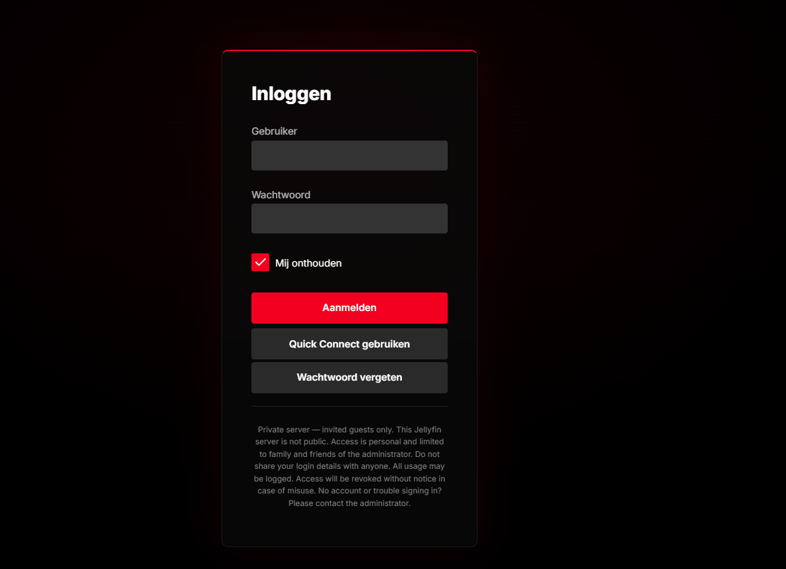

# Redline — Jellyfin Theme

A clean, streaming-style dark theme for Jellyfin. Black and red, with left-aligned layouts and quiet hover effects.

**Version 1.0** · Tested on **Jellyfin 10.11** (web client: desktop, ultrawide, mobile and TV layout).


| Details | Library |
|---|---|
|  |  |

| Login |
|---|
|  |

## Features

- Deep black `#141414` with a single red accent `#E50914`
- Inter font, clean section titles with a thin red bar
- Cards that grow on hover (downwards, so they never cover the row title), with the title text moving along
- Hero detail page: full backdrop, logo bottom-left, title, white play button, round action buttons
- Neat track selection (video / audio / subtitles), external links as pills, credits list
- Red progress bars, sliders and accent buttons (no Jellyfin blue left)
- Glass login card with room for a login disclaimer
- Works with video playback (background stays transparent while playing)
- Mobile: clean detail page without the floating thumbnail, 3 posters per row, no alphabet bar
- TV layout supported

## Installation

### Quick install (one line)

1. Open **Dashboard → General → Branding**.
2. Put one of these lines in **Custom CSS code**:

   Stable version 1.0 (recommended, never changes unexpectedly):

   ```css
   @import url("https://cdn.jsdelivr.net/gh/Nickhoog/redline-jellyfin-theme@v1.0/redline.css");
   ```

   Always the latest version (auto-updates, the CDN can take up to a day to refresh):

   ```css
   @import url("https://cdn.jsdelivr.net/gh/Nickhoog/redline-jellyfin-theme@main/redline.css");
   ```

3. Click **Save** and reload the page with `Ctrl + F5`.

Any own tweaks go **below** the `@import` line.

### Manual install

Paste the full contents of [`redline.css`](redline.css) into **Custom CSS code** instead. Use this if you want to edit the theme yourself or don't want automatic updates.

### Login disclaimer (optional)

Paste one of these into **Login disclaimer** and edit the text:

- English: [`login-disclaimer-en.html`](login-disclaimer-en.html)
- Dutch: [`login-disclaimer.html`](login-disclaimer.html)

On TV or phone apps, close the app once completely so the new CSS is loaded.

## Customizing

All main colours live in `:root` at the top of `redline.css`:

```css
--bg:   #141414;  /* background   */
--red:  #e50914;  /* accent colour */
--r-card: 10px;   /* card radius  */
```

## Changelog

- **1.0** — first stable release: cleaned-up CSS, mobile improvements, TV layout tested.

## License

[MIT](LICENSE) — free to use, modify and share.
