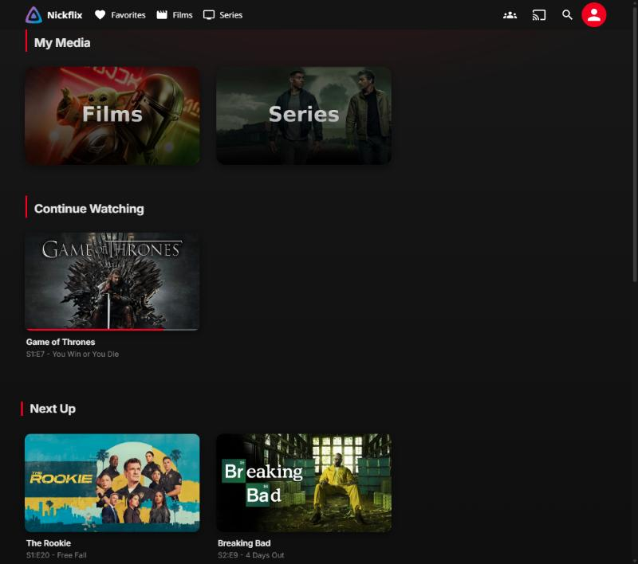
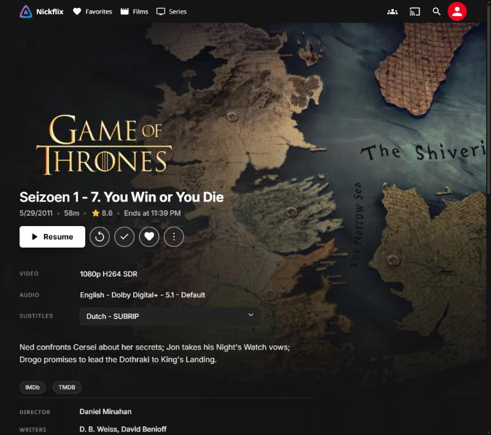
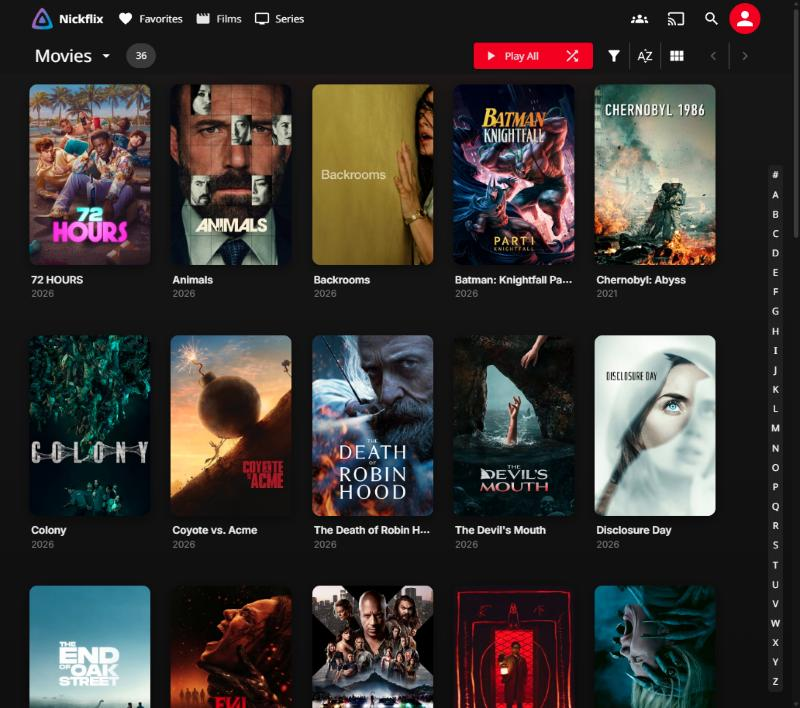

# Redline — Jellyfin Theme

A clean, streaming-style dark theme for Jellyfin. Black and red, with left-aligned layouts and quiet hover effects.

Tested on **Jellyfin 10.11** (web client, desktop and ultrawide).



| Details | Library |
|---|---|
|  |  |

## Features

- Deep black `#141414` with a single red accent `#E50914`
- Inter font, clean section titles with a thin red bar
- Cards that grow on hover (downwards, so they never cover the row title), with the title text moving along
- Hero detail page: full backdrop, logo bottom-left, title, white play button, round action buttons
- Neat track selection (video / audio / subtitles), external links as pills, credits list
- Red progress bars, sliders and accent buttons (no Jellyfin blue left)
- Glass login card with room for a login disclaimer
- Works with video playback (background stays transparent while playing)

## Installation

1. Open **Dashboard → General → Branding**.
2. Paste the contents of [`redline.css`](redline.css) into **Custom CSS code**.
3. Optional: paste [`login-disclaimer.html`](login-disclaimer.html) into **Login disclaimer** and edit the text.
4. Click **Save** and reload the page with `Ctrl + F5`.

On TV or phone apps, close the app once completely so the new CSS is loaded.

## Customizing

All main colours live in `:root` at the top of `redline.css`:

```css
--bg:   #141414;  /* background   */
--red:  #e50914;  /* accent colour */
--r-card: 10px;   /* card radius  */
```
